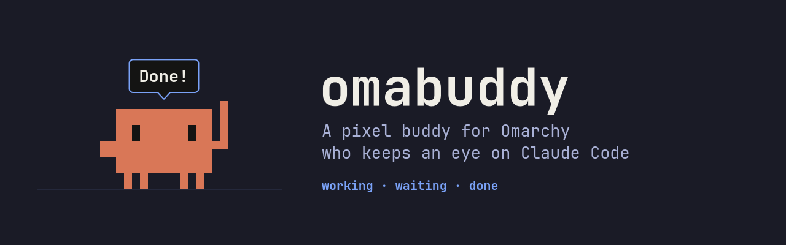
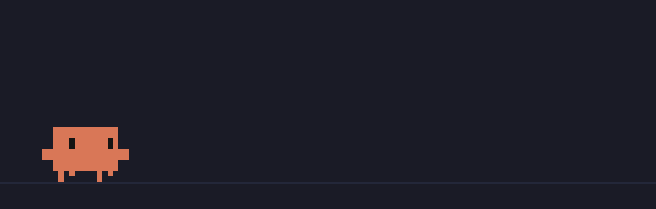
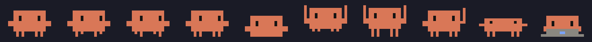

<p align="center"></p>

# Omabuddy

<p align="center"></p>

A little pixel buddy for [Omarchy](https://omarchy.org) who walks along the
bottom of your screen and keeps an eye on Claude Code for you.

On his own he wanders, sits, naps, looks around, and hops. Click him and he
waves; drag him and you can throw him. Hook him up to Claude Code and he
follows every session you have open:

| Claude Code | Buddy |
| --- | --- |
| Working on your prompt | Sits at his laptop and says what's going on: "Reading main.cpp", "Editing pet.cpp", "Run the tests" |
| Asking for permission | Stands up, waves now and then, and asks "Can I use Bash?" until you answer |
| Waiting for your reply | "Your turn!" |
| Done | Jumps for joy: "Done!" |

With several sessions open, a question beats work, and work beats done; he
says which project he means ("blog: Can I use Bash?"). A session whose
terminal was closed is forgotten within a few seconds.

He lives on a transparent layer-shell surface above your windows and below
fullscreen apps. Only Buddy himself takes the pointer, so everything around
him clicks through as usual, and he never takes the keyboard.

## Install

On Omarchy:

```sh
git clone https://github.com/yasaricli/omabuddy.git
cd omabuddy
bin/install
omabuddy hooks install
```

`bin/install` builds the package and installs it with `makepkg`, so Omabuddy
shows up in the app launcher (`Super + Space`). Launching it again sends him
home. `omabuddy hooks install` connects him to Claude Code (see below).

To toggle him with a key, add this to `~/.config/hypr/bindings.conf`:

```ini
bindd = SUPER SHIFT, B, Omabuddy, exec, omabuddy toggle
```

To have him out whenever you log in, add this to
`~/.config/hypr/autostart.conf`:

```ini
exec-once = uwsm-app -- omabuddy
```

## Claude Code

```sh
omabuddy hooks install
```

adds Omabuddy's hooks to `~/.claude/settings.json`, next to anything already
there. Running it again replaces them rather than adding more; a settings file
that isn't valid JSON is left untouched. Sessions started afterwards report to
Buddy.

Each hook runs `omabuddy hook`, which passes the event, the session, and the
Claude process it came from to Buddy. It never gets in Claude Code's way: with
Buddy not out, the event just goes nowhere.

`omabuddy hooks uninstall` removes the hooks again.

## On screen



| Action | What he does |
| --- | --- |
| Click | Waves and says hi (wakes up if napping) |
| Drag | Picks him up; let go mid-swing to throw him |
| Right-click | Waves goodbye and leaves |

## Commands

| Command | |
| --- | --- |
| `omabuddy` | Let him out, or make him wave if he's out |
| `omabuddy toggle` | Let him out, or send him home |
| `omabuddy quit` | Send him home |
| `omabuddy hello` | Make him wave |
| `omabuddy say <text>` | Put words in his mouth |
| `omabuddy state <state>` | `working`, `waiting`, `done`, or `idle` |
| `omabuddy hooks install` | Follow every Claude Code session |
| `omabuddy hooks uninstall` | Stop following them |
| `omabuddy hooks` | Print the hooks instead of installing them |
| `omabuddy hook` | Read one hook event on stdin (the hooks run this) |

Every command takes `--json`, and exits 0 or 1 with the error on stderr.

## Language and theme

Buddy follows the Omarchy accent and window rounding live, and speaks the
language picked under Setup > Language. Translations live in `src/i18n/`, one
JSON file per Omarchy language code; English needs none.

## Develop

```sh
bin/build   # build/omabuddy
bin/test    # tests, offscreen
```

C++ and Qt Quick, built with `qmake6` and `make`. It needs `qt6-base`,
`qt6-declarative`, `qt6-wayland`, and `layer-shell-qt`, which Omarchy already
has.

## Uninstall

```sh
omabuddy hooks uninstall
sudo pacman -R omabuddy
```

---

Omabuddy is a fan project and isn't affiliated with or endorsed by Anthropic.
Claude and Claude Code are trademarks of Anthropic.
